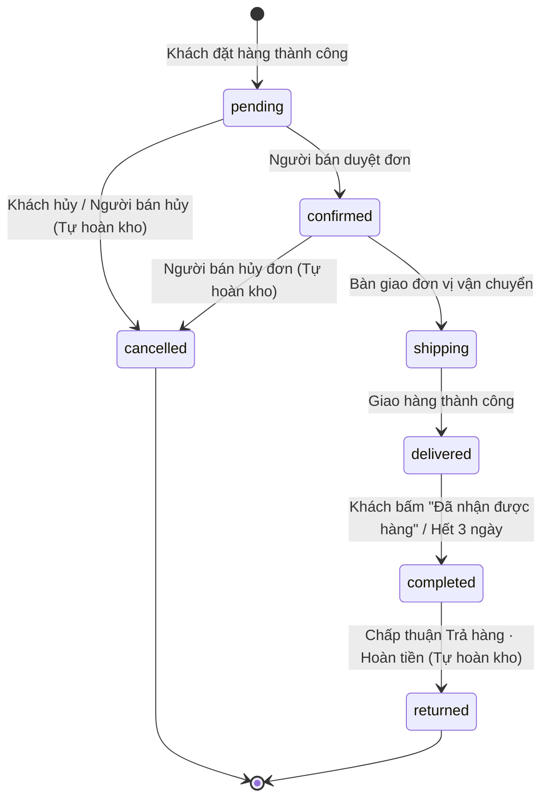

# ♻️ Đồ Cũ Còn Thương — Chợ đồ second-hand nhiều shop

> Website thương mại điện tử đồ cũ mô hình chợ nhiều shop (giống Shopee thu nhỏ), có giao diện riêng cho người mua và người bán, dữ liệu dùng chung theo thời gian thực trên Firebase.

[](https://react.dev/)
[](https://www.typescriptlang.org/)
[](https://vite.dev/)
[](https://firebase.google.com/)
[](https://vercel.com/)

🌐 **Dùng thử trực tiếp: [https://nhiptaman.store](https://nhiptaman.store)**

---

## 📑 Mục lục

1. [Giới thiệu dự án](#1-giới-thiệu-dự-án)
2. [Ảnh chụp màn hình](#2-ảnh-chụp-màn-hình)
3. [Tính năng chính](#3-tính-năng-chính)
4. [Luồng trạng thái đơn hàng](#4-luồng-trạng-thái-đơn-hàng)
5. [Công nghệ sử dụng](#5-công-nghệ-sử-dụng)
6. [Hướng dẫn chấm thử nhanh trên web (dành cho thầy cô)](#6-hướng-dẫn-chấm-thử-nhanh-trên-web-dành-cho-thầy-cô)
7. [Chạy dự án trên máy (localhost)](#7-chạy-dự-án-trên-máy-localhost)
8. [Cấu trúc thư mục](#8-cấu-trúc-thư-mục)
9. [Cơ sở dữ liệu Firestore](#9-cơ-sở-dữ-liệu-firestore)
10. [Bảo mật & giới hạn](#10-bảo-mật--giới-hạn)

---

## 1. Giới thiệu dự án

Thị trường đồ cũ (second-hand) tại Việt Nam sở hữu tiềm năng rất lớn với vô vàn món đồ độc bản còn giá trị sử dụng cao, tuy nhiên người mua trực tuyến thường e ngại bởi tình trạng hàng hóa không được mô tả trung thực và thiếu sự cam kết bảo chứng. **Đồ Cũ Còn Thương** được xây dựng nhằm giải quyết triệt để rào cản này: mỗi sản phẩm đăng bán đều bắt buộc công khai rõ ràng tỷ lệ độ mới (%), ảnh chụp cận cảnh từng khuyết điểm thật và có quy trình kiểm định chất lượng minh bạch. Nền tảng mang đến trải nghiệm mua sắm an tâm thông qua tính năng trả giá trực tiếp với chủ tiệm, khung chat thời gian thực có gắn thẻ đơn hàng/sản phẩm, hành trình vận chuyển cập nhật chi tiết từng chặng và chính sách khiếu nại trả hàng – hoàn tiền trong vòng 3 ngày. Dự án áp dụng mô hình chợ thương mại điện tử đa người bán (multi-vendor marketplace), cho phép mỗi người bán tự mở gian hàng riêng, chủ động đăng bán sản phẩm, quản lý kho hàng, tạo mã giảm giá và theo dõi doanh thu độc lập.

> ⚠️ **Lưu ý quan trọng:** Đây là dự án bài tập phục vụ mục đích học tập và nghiên cứu học phần; toàn bộ các giao dịch thanh toán bằng thẻ, số tài khoản và mã OTP trên hệ thống đều là **MÔ PHỎNG**, hoàn toàn không kết nối cổng thanh toán thật hay tiền tệ thực tế.

---

## 2. Ảnh chụp màn hình

| Gian hàng tiêu biểu | Chi tiết sản phẩm & độ mới |
| :---: | :---: |
|  |  |
| *Gian hàng Đồ Cũ Còn Thương* | *Bàn phím cơ Keychron K2 (Chi tiết độ mới & khuyết điểm)* |
| **Kênh người bán (Shop Retro Tech)** | **Sản phẩm văn hoá & sách cũ** |
|  |  |
| *Kênh người bán / Gian hàng Retro Tech* | *Sách "Nhà giả kim" bản cũ (Độ mới 80%)* |

> 💡 **Ghi chú:** Hình ảnh sản phẩm trong bộ dữ liệu mẫu ban đầu là ảnh minh họa được tạo bằng AI để phục vụ thử nghiệm giao diện.

---

## 3. Tính năng chính

### 👤 Khách vãng lai
- **Dạo chợ & Khám phá:** Xem toàn bộ danh sách sản phẩm trên sàn, xem các bộ sưu tập hàng mới về, đồ độc bản vintage.
- **Tìm kiếm thông minh:** Ô tìm kiếm trực tiếp trên thanh điều hướng hỗ trợ gợi ý tự động (autocomplete) theo tên sản phẩm và tên gian hàng.
- **Bộ lọc đa chiều:** Lọc theo danh mục hàng hóa, khoảng giá (từ - đến), tỷ lệ độ mới tối thiểu (%), trạng thái còn hàng và sắp xếp (mới nhất, giá tăng dần, giá giảm dần).
- **Xem chi tiết sản phẩm:** Thư viện ảnh sản phẩm đa góc độ, thông số % độ mới, hình ảnh và mô tả khuyết điểm thực tế, huy hiệu kiểm định chất lượng, chính sách đổi trả và danh sách đánh giá từ người mua trước.
- **Xem gian hàng riêng biệt:** Truy cập trang shop của từng người bán để xem thông tin giới thiệu, tỷ lệ đánh giá uy tín và toàn bộ sản phẩm của riêng shop đó.
- **Rào chắn thao tác:** Khách vãng lai có thể xem thông tin thoải mái; khi thực hiện các hành động mua hàng, trả giá hoặc gửi tin nhắn chat, hệ thống sẽ yêu cầu đăng nhập.

### 🛍️ Người mua (Buyer)
- **Đăng ký & Đăng nhập tiện lợi:** Đăng ký tài khoản nhanh chóng bằng số điện thoại 10 số (bắt đầu bằng `0`) và mật khẩu từ 8 ký tự.
- **Giỏ hàng đa shop:** Thêm sản phẩm từ nhiều cửa hàng khác nhau; hệ thống tự động gom nhóm theo từng shop và tính toán tách đơn hàng độc lập khi thanh toán.
- **Mã giảm giá theo từng shop:** Áp dụng mã coupon riêng cho từng gian hàng (giảm theo %, giảm số tiền cố định hoặc miễn phí vận chuyển); có gợi ý sẵn các mã khả dụng của shop ngay dưới danh sách món.
- **Thanh toán mô phỏng an toàn:**
  - Hỗ trợ thanh toán thẻ quốc tế (Visa/Mastercard) với thuật toán kiểm tra Luhn.
  - Hỗ trợ thẻ ATM nội địa NAPAS kèm bước xác thực mã OTP mô phỏng 6 ô số.
  - Hỗ trợ phương thức thanh toán khi nhận hàng (COD).
- **Thương lượng trả giá (Offer):** Gửi đề xuất mức giá mong muốn cho shop; nhận phản hồi đồng ý, từ chối hoặc nhận mức giá đề nghị lại (counter-offer) từ người bán và mua ngay với giá đã thỏa thuận.
- **Theo dõi đơn hàng thời gian thực:** Quản lý đơn mua theo các tab trạng thái; xem timeline chi tiết lộ trình vận chuyển qua từng mốc (bàn giao đơn vị vận chuyển, nhập kho phân loại, đang giao hàng, giao thành công).
- **Hủy đơn linh hoạt:** Người mua được quyền tự hủy đơn hàng khi đơn còn ở trạng thái Chờ xác nhận (hệ thống tự động hoàn lại số lượng tồn kho sản phẩm).
- **Xác nhận & Đánh giá:** Bấm xác nhận "Đã nhận được hàng" và gửi đánh giá chấm điểm từ 1 đến 5 sao, kèm nhận xét, gắn thẻ tiêu chí nhanh và đính kèm hình ảnh/video thực tế.
- **Khiếu nại Trả hàng – Hoàn tiền:** Gửi yêu cầu trả hàng trong vòng 3 ngày sau khi nhận hàng thành công kèm lý do chi tiết và hình ảnh bằng chứng.
- **Nhắn tin trực tiếp (Live Chat):** Trò chuyện thời gian thực với chủ shop, hỗ trợ đính kèm thẻ sản phẩm hoặc thẻ đơn hàng trực tiếp trong khung chat.
- **Tiện ích cá nhân:** Lưu danh sách sản phẩm yêu thích (Wishlist), bấm theo dõi gian hàng yêu thích, quản lý ví voucher đã lưu, lưu trữ sổ địa chỉ nhận hàng, chuông thông báo đẩy thời gian thực và đổi mật khẩu tài khoản.

### 🏪 Người bán (Seller)
- **Đăng ký gian hàng độc lập:** Đăng ký tài khoản người bán bằng tên đăng nhập và hoàn thành wizard thiết lập thông tin shop (tên shop, giới thiệu, ảnh đại diện, màu sắc chủ đạo).
- **Tổng quan kinh doanh (Dashboard):** Xem thống kê tổng doanh thu thực tế, số lượng đơn hàng theo từng trạng thái và biểu đồ tổng quan tình hình kinh doanh.
- **Quản lý sản phẩm (CRUD):** Thêm sản phẩm mới, cập nhật thông tin, chỉnh sửa giá bán/giá gốc, bật/tắt hiển thị hoặc xóa sản phẩm; tự động nén tối ưu dung lượng ảnh tải lên ngay tại trình duyệt; điền chi tiết khuyết điểm và chứng nhận kiểm định.
- **Xử lý đơn hàng:** Tiếp nhận đơn hàng mới theo thời gian thực; duyệt đơn (chuyển sang Chờ lấy hàng) hoặc hủy đơn kèm lý do giải thích (tự động hoàn kho).
- **Điều phối vận chuyển:** Chọn đơn vị vận chuyển đối tác, hệ thống tự sinh mã vận đơn hợp lệ; gửi báo cáo tiến độ từng chặng (Đã bàn giao → Đến kho phân loại → Đang giao hàng → Giao thành công / Giao thất bại).
- **Công cụ hỗ trợ vận hành:** Bảng Kanban trực quan theo dõi luồng giao hàng, tính năng xem và in phiếu giao hàng chuẩn khổ A6, xuất toàn bộ danh sách đơn ra file CSV để quản lý ngoại tuyến.
- **Xử lý trả giá:** Tiếp nhận các lời đề nghị giá từ người mua với 3 tùy chọn: Đồng ý (chấp thuận giá), Trả giá lại (gửi mức giá mới) hoặc Từ chối.
- **Xử lý trả hàng – hoàn tiền:** Xem xét yêu cầu khiếu nại của người mua; bấm xác nhận hoàn tiền thì hệ thống tự động hoàn lại số lượng tồn kho cho sản phẩm đó.
- **Chăm sóc khách hàng & Đánh giá:** Tiếp nhận và trả lời tin nhắn từ người mua trong hộp chat; xem và viết phản hồi công khai cho các đánh giá của khách hàng.
- **Khuyến mãi riêng của shop:** Tự tạo các mã giảm giá cho gian hàng với điều kiện đơn hàng tối thiểu, mức giảm tối đa và giới hạn lượt sử dụng.
- **Bảo mật đa gian hàng:** Phân quyền tuyệt đối — mỗi người bán chỉ có thể xem, chỉnh sửa và quản lý sản phẩm, đơn hàng, trả giá và doanh thu của chính shop mình.

### ⚙️ Hệ thống & Kiến trúc
- **Dữ liệu thời gian thực (Real-time):** Sử dụng các listener `onSnapshot` của Cloud Firestore để đồng bộ tức thì giỏ hàng, đơn hàng, số lượng tồn kho, tin nhắn chat, lời trả giá và thông báo giữa các thiết bị mà không cần tải lại trang.
- **Phân quyền chặt chẽ:** Toàn bộ dữ liệu được bảo vệ bằng Firestore Security Rules phía máy chủ, ngăn chặn truy cập trái phép hoặc ghi đè dữ liệu giữa các người dùng và các shop.
- **Nén ảnh tại máy khách (Client-side Image Compression):** Tự động nén ảnh sản phẩm về kích thước tối ưu ngay trên trình duyệt trước khi ghi vào Firestore, không phụ thuộc dịch vụ lưu trữ ngoài.
- **Thiết kế phản hồi (Responsive Design):** Tối ưu hóa trải nghiệm hiển thị từ màn hình di động nhỏ, máy tính bảng đến máy tính để bàn.
- **Trang hỗ trợ người dùng:** Tích hợp trang lỗi 404 thân thiện và các trang thông tin chính sách đổi trả hàng, chính sách vận chuyển và hướng dẫn thanh toán.

---

## 4. Luồng trạng thái đơn hàng

Hệ thống quản lý đơn hàng tuân theo quy trình khép kín, tự động hoàn kho khi đơn bị hủy hoặc chấp thuận trả hàng:



### 📝 Ghi chú về quy tắc nghiệp vụ:
- **Tự động hoàn kho:** Khi đơn hàng bị hủy ở trạng thái `pending` (Chờ xác nhận) hoặc `confirmed` (Chờ lấy hàng), toàn bộ số lượng các món trong đơn lập tức được cộng ngược lại vào tồn kho sản phẩm. Tương tự, khi người bán duyệt yêu cầu "Trả hàng · Hoàn tiền", sản phẩm cũng được tự động hoàn kho.
- **Cập nhật thanh toán COD:** Với đơn hàng thanh toán khi nhận hàng (COD), khi người bán gửi báo cáo sự kiện `Giao hàng thành công` (`delivered`), trạng thái thanh toán của đơn hàng sẽ tự động chuyển từ *"Chưa thanh toán"* sang *"Đã thanh toán"*.
- **Hoàn tiền mô phỏng:** Nếu đơn hàng đã thanh toán bằng thẻ mà bị hủy hoặc được chấp thuận trả hàng, trạng thái thanh toán tự động cập nhật thành *"Đã hoàn tiền (mô phỏng)"*.

---

## 5. Công nghệ sử dụng

| Thành phần | Công nghệ & Phiên bản | Ghi chú kiến trúc |
| :--- | :--- | :--- |
| **Giao diện người dùng (UI)** | **React 19** (`react@^19.0.1`), `react-dom@^19.0.1` | Kiến trúc Component hướng chức năng kết hợp React Hooks |
| **Biểu tượng (Icons)** | **Lucide React** (`lucide-react@^0.546.0`) | Bộ icon hiện đại, tối ưu kích thước bundle |
| **Hiệu ứng chuyển động** | **Motion** (`motion@^12.23.24`) | Hiệu ứng chuyển cảnh mượt mà cho giỏ hàng và modal |
| **Ngôn ngữ lập trình** | **TypeScript 7** (`typescript@^7.0.2`) | Định kiểu tĩnh an toàn, tự động phát hiện lỗi khi build |
| **Công cụ đóng gói (Bundler)** | **Vite 8** (`vite@^8.3.0`) | Tốc độ biên dịch và Hot Module Replacement (HMR) cực nhanh |
| **Styling & Giao diện** | **Tailwind CSS v4** (`tailwindcss@^4.3.3`) | CSS framework hiện đại thông qua plugin `@tailwindcss/vite` |
| **Định tuyến (Routing)** | **Client-side Routing** & HTML5 History API | Điều phối URL động, kết hợp cấu hình rewrite trên Vercel |
| **Cơ sở dữ liệu (Database)** | **Cloud Firestore** (`firebase@^11.0.0`) | Cơ sở dữ liệu NoSQL phân tán, hỗ trợ lắng nghe thời gian thực |
| **Xác thực người dùng (Auth)** | **Firebase Authentication** | Quản lý phiên đăng nhập an toàn (Email/Password với email nội bộ) |
| **Lưu trữ hình ảnh** | **Client-side Data URL & Seed Media** | Ảnh được nén trực tiếp tại trình duyệt + ảnh tĩnh trong `public/seed` (không dùng Firebase Storage) |
| **Triển khai máy chủ (Deploy)** | **Vercel** (kết nối trực tiếp từ GitHub) | Tự động CI/CD khi push code, định cấu hình qua `vercel.json` |
| **Tên miền chính thức** | **nhiptaman.store** | Tên miền riêng được trỏ DNS về hạ tầng Vercel |
| **Công cụ phát triển** | **Google AI Studio** | Hỗ trợ tối ưu hóa và kiểm thử tự động |

---

## 6. Hướng dẫn chấm thử nhanh trên web (dành cho thầy cô)

> 💡 **Khuyến nghị:** Thầy cô nên sử dụng trình duyệt **Google Chrome** và mở song song **2 cửa sổ**: một cửa sổ thông thường (đóng vai Người mua) và một cửa sổ ẩn danh (đóng vai Người bán) để quan sát rõ nhất tính năng đồng bộ thời gian thực giữa 2 tài khoản mà không cần tải lại trang.

### Bước 1: Mở ứng dụng
Truy cập liên kết chính thức: **[https://nhiptaman.store](https://nhiptaman.store)**

### Bước 2: Trải nghiệm vai Người mua (Cửa sổ thường)
1. Bấm nút **Đăng ký** ở góc trên bên phải → chọn tab **"Tôi là người mua"**.
2. Nhập một **số điện thoại 10 số bất kỳ bắt đầu bằng số `0`** (ví dụ: `0912345678`) và mật khẩu từ 8 ký tự trở lên → bấm **Đăng ký tài khoản**.
3. Tại trang chủ mua sắm, thầy cô chọn thêm 1–2 sản phẩm của các shop khác nhau vào giỏ (ví dụ: một cuốn sách của shop *Góc Sách & Nhạc* và một món phụ kiện của shop *Đồ Cũ Còn Thương*).
4. Bấm vào biểu tượng **Giỏ hàng** trên Header → bấm **"Tiến hành đặt hàng"**.
5. Tại màn hình Thanh toán:
   - Giỏ hàng tự động chia danh sách món theo từng shop.
   - Thầy cô bấm vào danh sách mã giảm giá gợi ý sẵn dưới mỗi shop để áp dụng (ví dụ: mã `DOCU10`, `SACHHAY`, `FREESHIP`).
   - Nhập thông tin người nhận hàng và chọn phương thức thanh toán: **COD** hoặc **Thẻ tín dụng / Ghi nợ quốc tế** (sử dụng thông tin thẻ test ở bảng bên dưới).
   - Nếu chọn thanh toán thẻ, nhập mã OTP mô phỏng: `123456` → bấm **Xác nhận đặt hàng**.
6. Đơn hàng được tạo thành công; hệ thống tự động điều hướng sang trang **"Đơn mua"** với đầy đủ chi tiết từng đơn.

### Bước 3: Trải nghiệm vai Người bán (Cửa sổ ẩn danh)
1. Mở một cửa sổ trình duyệt ẩn danh (Ctrl + Shift + N) và truy cập lại `https://nhiptaman.store`.
2. Bấm nút **Đăng ký** → chọn tab **"Tôi là người bán"**.
3. Nhập một **tên đăng nhập** viết liền không dấu (ví dụ: `tiem_vintage_2026`) và mật khẩu → bấm **Đăng ký**.
4. Hoàn tất các bước thiết lập gian hàng nhanh (nhập tên tiệm, mô tả ngắn, chọn màu nhận diện) để mở shop.
5. Vào menu **Sản phẩm** → bấm **"Thêm sản phẩm"**: nhập tên món, chọn ảnh tải lên, % độ mới, mô tả khuyết điểm và giá bán → bấm **Đăng bán**.
6. Chuyển sang Cửa sổ 1 (Người mua), tìm kiếm và đặt mua chính sản phẩm vừa đăng.
7. Quay lại Cửa sổ 2 (Người bán) vào menu **Đơn hàng**: Đơn hàng mới xuất hiện ngay lập tức mà không cần tải lại trang.
8. Thầy cô bấm **"Duyệt đơn"**, sau đó chuyển sang mục **Vận chuyển**, chọn đơn vị giao hàng và lần lượt bấm gửi các báo cáo tiến độ:
   - *Đã bàn giao cho đơn vị vận chuyển*
   - *Đã đến kho phân loại*
   - *Đang vận chuyển liên tỉnh*
   - *Giao hàng thành công*
9. Quay lại Cửa sổ 1 (Người mua), quan sát thanh tiến trình lộ trình vận chuyển tự động chuyển màu và cập nhật mốc sự kiện thời gian thực.
10. Tại Cửa sổ 1 (Người mua), bấm **"Đã nhận được hàng"** → gửi đánh giá sao kèm nhận xét.
11. Thầy cô cũng có thể kiểm tra thêm:
    - **Tính năng Trả giá:** Người mua bấm "Trả giá" trong trang chi tiết món → Người bán nhận thông báo và gửi lại mức giá đề nghị (Counter-offer) → Người mua bấm chấp thuận để mua với giá thương lượng.
    - **Tính năng Chat trực tiếp:** Mở hộp thoại chat để nhắn tin trao đổi giữa người mua và người bán kèm thẻ sản phẩm.
    - **Tính năng Trả hàng – Hoàn tiền:** Người mua gửi yêu cầu hoàn tiền cho đơn đã giao → Người bán duyệt khiếu nại và hệ thống tự động hoàn kho.

### Bước 4: Bảng thông tin thẻ thử nghiệm (Mã OTP luôn là `123456`)

| Loại thẻ thử nghiệm | Số thẻ test | Ngày hết hạn | CVV | Kết quả mong đợi |
| :--- | :--- | :---: | :---: | :--- |
| **Visa Test (Thành công)** | `4111 1111 1111 1111` | Tháng/Năm tương lai (vd: `12/28`) | 3 số bất kỳ (vd: `123`) | Vượt qua thuật toán Luhn, nhập OTP `123456` tạo đơn thành công |
| **Visa Test (Bị từ chối)** | `4000 0000 0000 0002` | Tháng/Năm tương lai (vd: `10/28`) | 3 số bất kỳ (vd: `999`) | Ngân hàng từ chối thanh toán (`05_DECLINED`), không trừ tiền |
| **Thẻ ATM nội địa NAPAS** | `9704 1234 5678 9012` | Ngày phát hành (vd: `06/25`) | Không cần | Nhập OTP `123456`, thanh toán nội địa mô phỏng thành công |

### 📌 Ghi chú về 3 gian hàng mẫu & Bảng điều khiển demo:
- 3 gian hàng có sẵn trong hệ thống (*Đồ Cũ Còn Thương*, *Góc Sách & Nhạc*, *Retro Tech*) và tính năng "Điều khiển demo" được liên kết với các tài khoản quản trị của tác giả nhằm phục vụ buổi thuyết trình báo cáo đồ án.
- Để đảm bảo tính bảo mật và tính toàn vẹn của dữ liệu demo, thông tin đăng nhập của các tài khoản quản trị này không được công khai trên README. Nếu thầy cô có nhu cầu đăng nhập trực tiếp vào các tài khoản này để thẩm định, tác giả sẽ cung cấp thông tin riêng.
- Khi "Chế độ thuyết trình" đang được kích hoạt, các tài khoản đăng ký mới chỉ có quyền xem nội dung; khi chế độ này tắt, mọi tài khoản đều có thể tự do mua bán, trả giá, chat và tạo đơn hàng bình thường.

---

## 7. Chạy dự án trên máy (localhost)

### Yêu cầu môi trường
- **Node.js:** Phiên bản `18.x`, `20.x` hoặc mới hơn.
- **npm:** Đi kèm sẵn với cài đặt Node.js.

### Các lệnh cài đặt & khởi chạy

```bash
# 1. Tải mã nguồn dự án từ GitHub
git clone https://github.com/iamtofu2005s/do-cu-con-thuong.git

# 2. Di chuyển vào thư mục mã nguồn
cd do-cu-con-thuong

# 3. Cài đặt toàn bộ các thư viện phụ thuộc
npm install

# 4. Khởi chạy máy chủ phát triển
npm run dev
```

Mở trình duyệt web và truy cập địa chỉ: **[http://localhost:3000](http://localhost:3000)** (máy chủ Node.js/Express tích hợp Vite dev server lắng nghe tại cổng 3000 theo cấu hình trong `server.ts`).

### Biên dịch & Kiểm tra bản phát hành (Production Build)

```bash
# Biên dịch dự án thành các tệp tĩnh tối ưu trong thư mục dist/
npm run build

# Xem trước bản phát hành production trên máy local (mặc định cổng 4173)
npm run preview
```

### Cấu hình biến môi trường
- **Không cần cấu hình thêm file `.env`:** Cấu hình kết nối Firebase client đã được tích hợp sẵn trong mã nguồn tại `src/firebase.ts` (đây là các khóa công khai an toàn phía client, toàn bộ tài nguyên được bảo vệ bằng Firestore Security Rules).
- Tên miền `localhost` đã được cấu hình trong danh sách tên miền được phép xác thực của Firebase Authentication.
- Bản chạy cục bộ trên máy sẽ kết nối chung cơ sở dữ liệu Cloud Firestore với phiên bản triển khai trực tuyến trên Vercel, đảm bảo dữ liệu luôn đồng bộ.

### (Tùy chọn) Hướng dẫn triển khai với Project Firebase riêng
Nếu thầy cô hoặc bạn đọc muốn triển khai dự án với cơ sở dữ liệu Firebase độc lập hoàn toàn:
1. Đăng nhập vào [Firebase Console](https://console.firebase.google.com/) và tạo một Project mới.
2. Vào mục **Build → Authentication**, bấm Bắt đầu, chọn thẻ **Sign-in method** và kích hoạt phương thức **Email/Password**.
3. Vào mục **Build → Firestore Database**, bấm Tạo cơ sở dữ liệu (chọn chế độ Production).
4. Mở tab **Rules** trong Firestore Database, sao chép toàn bộ nội dung từ tệp `firestore.rules` ở thư mục gốc của dự án này, dán vào và bấm **Publish**.
5. Vào **Project Settings**, tạo Web App để lấy đối tượng `firebaseConfig`.
6. Mở tệp `src/firebase.ts` trong mã nguồn và thay thế giá trị của đối tượng `firebaseConfig` tương ứng.
7. Đăng ký một tài khoản người bán mới và trải nghiệm các tính năng đăng bán sản phẩm độc lập.

---

## 8. Cấu trúc thư mục

Cây thư mục mã nguồn thực tế của dự án:

```
do-cu-con-thuong/
├── public/
│   └── seed/                      # Hình ảnh sản phẩm mẫu và ảnh bìa các gian hàng mặc định
├── src/
│   ├── components/                # Toàn bộ các thành phần giao diện (UI Components)
│   │   ├── Header.tsx             # Thanh điều hướng trên cùng, tìm kiếm autocomplete, giỏ hàng, thông báo
│   │   ├── BuyerHomeView.tsx      # Giao diện mua sắm chính, danh mục, khối chào mừng, bộ lọc đa chiều
│   │   ├── ProductCard.tsx        # Thẻ sản phẩm chuẩn thẩm mỹ vintage, hiển thị % độ mới và giá
│   │   ├── ProductDetailModal.tsx # Xem chi tiết tình trạng sản phẩm, khuyết điểm, chứng nhận kiểm định
│   │   ├── CartDrawer.tsx         # Giỏ hàng trượt đa shop, phân nhóm theo shop và tính freeship
│   │   ├── CheckoutView.tsx       # Trang thanh toán đa shop, nhập mã giảm giá, form thẻ test & OTP
│   │   ├── OrdersView.tsx         # Trang quản lý đơn mua của khách hàng, timeline vận chuyển chi tiết
│   │   ├── SellerDashboard.tsx    # Bảng điều khiển người bán: KPI doanh thu, duyệt đơn và quản lý kho
│   │   ├── SellerShippingKanban.tsx # Bảng Kanban trực quan theo dõi và cập nhật trạng thái vận chuyển
│   │   ├── ShippingLabelModal.tsx # Mẫu in phiếu gửi hàng chuẩn khổ A6 cho người bán
│   │   ├── ShopView.tsx           # Trang gian hàng công khai của từng người bán
│   │   ├── ChatDrawer.tsx         # Khung chat trao đổi trực tiếp giữa người mua và người bán
│   │   ├── BuyerChatDock.tsx      # Thanh dock chat thu nhỏ tiện lợi cho người mua ở góc màn hình
│   │   ├── OfferModal.tsx         # Hộp thoại thương lượng và gửi lời trả giá cho sản phẩm
│   │   ├── ReviewModal.tsx        # Hộp thoại gửi đánh giá sao, nhận xét và đính kèm đa phương tiện
│   │   ├── ReturnRequestModal.tsx # Hộp thoại tạo yêu cầu trả hàng – hoàn tiền trong 3 ngày
│   │   ├── AccountView.tsx        # Trang quản lý hồ sơ người dùng, sổ địa chỉ và đổi mật khẩu
│   │   ├── AuthModal.tsx          # Hộp thoại đăng ký / đăng nhập riêng biệt cho Người mua và Người bán
│   │   └── NotFoundView.tsx       # Trang thông báo lỗi 404 thân thiện khi đường dẫn không tồn tại
│   ├── context/
│   │   ├── AuthContext.tsx        # Quản lý trạng thái xác thực và đồng bộ số lượng giỏ hàng thời gian thực
│   │   └── ToastContext.tsx       # Hệ thống hiển thị thông báo toast tức thì
│   ├── services/
│   │   ├── db.ts                  # Lớp truy vấn dữ liệu Cloud Firestore và thiết lập onSnapshot listener
│   │   └── api.ts                 # Lớp API wrapper chuẩn hóa các nghiệp vụ logic của hệ thống
│   ├── utils/
│   │   ├── format.ts              # Hàm định dạng tiền tệ VNĐ, ngày tháng và thuật toán kiểm tra thẻ Luhn
│   │   └── image.ts               # Thuật toán nén ảnh tự động ngay trên trình duyệt trước khi tải lên
│   ├── firebase.ts                # Cấu hình khởi tạo Firebase App, Auth và Cloud Firestore
│   ├── types.ts                   # Toàn bộ định nghĩa kiểu dữ liệu TypeScript (User, Product, Order...)
│   ├── App.tsx                    # Thành phần điều phối định tuyến và giao diện chính của ứng dụng
│   └── main.tsx                   # Điểm khởi động ứng dụng React
├── server.ts                      # Máy chủ phát triển Express kết hợp Vite dev middleware trên port 3000
├── firestore.rules                # Toàn bộ quy tắc bảo mật và phân quyền truy cập Cloud Firestore
├── vercel.json                    # Cấu hình triển khai Vercel, định tuyến SPA và tối ưu cache ảnh seed
├── package.json                   # Danh mục thư viện phụ thuộc và các script thực thi
└── tsconfig.json                  # Cấu hình trình biên dịch TypeScript
```

---

## 9. Cơ sở dữ liệu Firestore

Dữ liệu ứng dụng được lưu trữ tập trung trên Cloud Firestore với các collection thực tế sau:

| Tên Collection | Mô tả vai trò & Dữ liệu lưu trữ |
| :--- | :--- |
| `users` | Thông tin hồ sơ người dùng (`role`, `full_name`, `phone`, `shopId`, sổ địa chỉ, `wishlist`, `followingShops`, `savedCoupons`). |
| `usernames` | Bảng chỉ mục ánh xạ tên đăng nhập / SĐT sang `uid` phục vụ kiểm tra trùng lặp và xác thực đăng nhập nhanh. |
| `shops` | Danh sách các gian hàng trên chợ (`name`, `slug`, `ownerUid`, ảnh bìa, avatar SVG, số người theo dõi, đánh giá trung bình). |
| `products` | Kho sản phẩm đăng bán (`name`, `price`, `original_price`, `stock`, `condition_pct`, khuyết điểm, chứng nhận kiểm định, `shopId`, `ownerUid`). |
| `carts` | Giỏ hàng người mua theo từng `userId` (`items`, số lượng, giá thương lượng nếu có, thông tin shop). |
| `orders` | Dữ liệu đơn đặt hàng (`code`, `buyerUid`, `sellerUid`, `items`, tổng tiền, giảm giá, phương thức thanh toán, `status`, `shipmentEvents`). |
| `offers` | Danh sách đề xuất trả giá (`buyerUid`, `sellerUid`, `productId`, giá gốc, giá đề xuất, giá phản hồi, `status`). |
| `returns` | Yêu cầu khiếu nại trả hàng – hoàn tiền (`orderCode`, `buyerUid`, `shopId`, lý do, hình ảnh bằng chứng, số tiền hoàn, `status`). |
| `reviews` | Đánh giá nhận xét sản phẩm (`productId`, `buyerUid`, số sao, nội dung, tiêu chí nhanh, ảnh/video, phản hồi từ shop). |
| `coupons` | Mã giảm giá của các shop (`code`, `shopId`, loại giảm %, mức giảm cố định, giảm tối đa, đơn tối thiểu, lượt đã dùng). |
| `conversations` | Danh sách các cuộc trò chuyện giữa người mua và từng shop; subcollection `messages` lưu trữ chi tiết từng tin nhắn. |
| `notifications` | Hộp thông báo của từng người dùng (`toUid`, tiêu đề, nội dung, trạng thái đã đọc, liên kết đơn hàng). |
| `config` | Lưu trữ cấu hình toàn cục của hệ thống (ví dụ: cờ `presentationMode`). |
| `seedMedia` | Lưu trữ cấu hình đường dẫn hình ảnh mặc định phục vụ quá trình seed dữ liệu thử nghiệm. |

### 🛡️ Phân quyền dữ liệu (Security Rules):
- **Người mua:** Chỉ có quyền đọc và chỉnh sửa giỏ hàng (`carts`), danh sách đơn hàng (`orders`), yêu cầu trả giá (`offers`), khiếu nại (`returns`) và tin nhắn chat thuộc về chính tài khoản của mình (`buyerUid == request.auth.uid`).
- **Người bán:** Chỉ có quyền xem và chỉnh sửa sản phẩm (`products`), đơn hàng (`orders`), quản lý vận chuyển, xử lý trả giá và trả lời khiếu nại thuộc về gian hàng mà mình làm chủ sở hữu (`sellerUid == request.auth.uid` hoặc `shopOwner(shopId)`).
- **Tài khoản quản trị chủ tiệm:** Được định danh an toàn qua email nội bộ trong `firestore.rules` để thực hiện các thao tác quản trị đặc biệt như kích hoạt Chế độ thuyết trình hoặc khôi phục dữ liệu demo.

---

## 10. Bảo mật & giới hạn

- **Thanh toán mô phỏng an toàn:** Ứng dụng không kết nối cổng thanh toán thật và tuyệt đối không lưu trữ số thẻ tín dụng đầy đủ hay mã bảo mật CVV vào cơ sở dữ liệu; hệ thống chỉ lưu loại thẻ và 4 chữ số cuối cùng để phục vụ hiển thị lịch sử đối soát của người mua.
- **Bảo mật tài khoản:** Mật khẩu đăng nhập được ủy quyền xử lý trực tiếp cho hạ tầng an ninh của Google Firebase Authentication; mã nguồn hoàn toàn không lưu trữ mật khẩu ở dạng văn bản thuần túy.
- **Tối ưu hóa không dùng Firebase Storage:** Để hạn chế chi phí hạ tầng và đảm bảo khả năng triển khai linh hoạt, ứng dụng tích hợp sẵn thuật toán nén ảnh tại máy khách (Canvas API Compression) để lưu trữ hình ảnh tải lên ngay trong Firestore; các video đánh giá được lưu trữ cục bộ trên trình duyệt của người gửi.
- **Phạm vi đồ án:** Ứng dụng được xây dựng độc lập nhằm phục vụ mục đích nghiên cứu, học tập và báo cáo đồ án môn học.

---

© 2026 Đồ Cũ Còn Thương — Dự án học tập.
